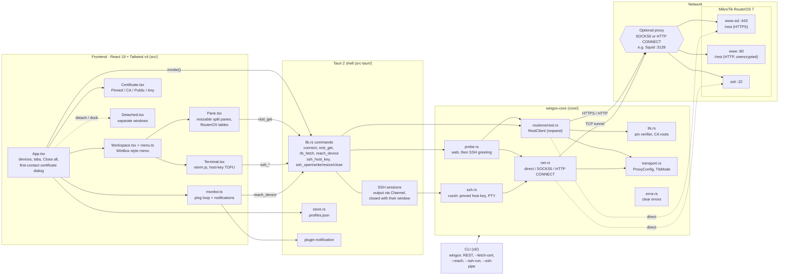

# Wingox — Technical Design

> Status: draft · 2026-11-05 · Working locally (no Git repository yet).
> This document and its Spanish twin ([DESIGN.es.md](DESIGN.es.md)) are kept in
> sync: change both when the design changes.

## 1. Overview

**Wingox** is a cross-platform desktop application to manage MikroTik
routers (RouterOS), built as a modern alternative to MikroTik's **WinBox**.

**Why it exists.** WinBox has no proxy setting, so you cannot manage a router
that lives on another network, behind a proxy or a jump host. This application
makes **connecting through a proxy or an SSH jump a first-class feature**: every
saved connection can route its traffic through a SOCKS5 / HTTP CONNECT proxy or
an SSH jump host. On top of that it adds what WinBox lacks: managing many
routers at once, configuration **versioning and diffs**, **automation**, and
**observability**.

It is built on the **official RouterOS APIs** (REST and the binary API), not on
WinBox's proprietary protocol.

## 2. Background: how WinBox works

From a static reverse-engineering pass over WinBox 4 (`WinBox.exe`):

- WinBox 4 is a **Qt 6.8.8 / QML** application, cross-platform (WinBox 3 was a
  tiny native Win32 binary).
- It is a **generic renderer, not a set of fixed screens.** It carries no
  RouterOS menu paths. On connect it downloads from the router an *index file*,
  *skins*, and *JavaScript files*, and builds the menus and the per-screen logic
  from them. The features you see in WinBox come from RouterOS, not from WinBox.
- Transport is a proprietary protocol over **TCP 8291**, with typed name-value
  messages (`nv::message`) and a chunked file-transfer sublayer (`mproxy`).

**Implication for us.** We do not reimplement WinBox's screens. We build a
better *client* on documented APIs, and let RouterOS be the source of truth for
what a router can do. The proprietary 8291 protocol is **out of scope for v1**;
it is only needed to reach an unconfigured router with no IP (WinBox's MAC /
neighbor connection). We may reverse it later if that use case matters.

## 3. Goals and non-goals

**Goals**
- Connect to RouterOS through an optional proxy or SSH jump (the reason for the project).
- Build on the official RouterOS APIs (REST + binary API).
- Cross-platform desktop (Windows, macOS, Linux).
- Manage many routers: inventory, groups, bulk actions.
- Configuration versioning, diffs, and rollback.
- Automation: templates, scripts, scheduled tasks, declarative apply with a dry-run.
- Observability: live metrics, graphs, discovered topology.
- Safe by default: a "safe mode" / dry-run before applying changes; secrets never in plaintext.

**Non-goals (v1)**
- Reversing or reimplementing the proprietary WinBox 8291 protocol.
- MAC / neighbor connection to an unconfigured router with no IP.
- Mobile apps.
- Managing non-MikroTik devices.

## 4. Architecture

A **Tauri 2** application: a Rust core plus a React/TypeScript UI in the webview.

Why Tauri: a browser sandbox cannot open raw TCP, do its own TLS, or speak
SOCKS5 / SSH. The Rust side can, which is exactly what proxy connectivity and
the binary API need. Tauri also gives small binaries and the three desktop OSes
from one codebase, and it reuses the React/TypeScript stack already used in
visual-tracert.

```
┌──────────────────────────────────────────────┐
│ UI — React / TypeScript (webview)            │
│  inventory · connection editor · browser ·   │
│  diffs · automation · dashboards             │
└───────────────┬──────────────────────────────┘
                │ Tauri commands (typed IPC)
┌───────────────▼──────────────────────────────┐
│ Core — Rust                                  │
│  • connection manager                        │
│  • transport: direct │ SOCKS5 │ HTTP CONNECT │ SSH jump
│  • RouterOS clients: REST (HTTPS) · binary API (8728/8729)
│  • store: SQLite (metadata) + OS keychain (secrets)
│  • services: inventory · snapshots · automation · telemetry
└───────────────┬──────────────────────────────┘
                │ direct / SOCKS5 / HTTP CONNECT / SSH direct-tcpip
┌───────────────▼──────────────────────────────┐
│ RouterOS devices (REST / binary API)         │
└──────────────────────────────────────────────┘
```

### 4.1 As built (v0.1.0-alpha.1)

The box above is the target design. This is what exists today: the UI never
opens connections itself, everything goes through `invoke()` to the Tauri
commands; REST uses reqwest (which handles the proxy itself), while SSH and the
monitor's probe need the raw TCP stream and get it from `net.rs`.



## 5. Connecting to RouterOS

### 5.1 The official APIs

- **REST API** — RouterOS **7.1+** only. HTTPS on the device's `www-ssl`
  service, base path `/rest`, HTTP Basic auth, JSON bodies. CRUD maps to the
  config tree, e.g. `GET /rest/system/resource`, `GET /rest/interface`,
  `PATCH /rest/ip/address/<id>`, `PUT /rest/ip/address`, `POST .../add`,
  `DELETE`. Requires `www-ssl` enabled with a certificate on the router.
  A `www-ssl` with `certificate=none` only offers anonymous (ADH) ciphers, which
  no modern TLS client accepts: the handshake fails with a `handshake_failure`
  alert, and Wingox says so explicitly. For such routers a profile can choose
  **Protocol = HTTP** (the `www` service, port 80): REST works the same, but
  nothing is encrypted — the Basic-auth user/password and all data cross the
  proxy and the network in clear text. The UI shows a prominent warning when
  that protocol is chosen and marks the device and its tab as unencrypted; the
  real fix is assigning a certificate to `www-ssl`.
- **Trusting the certificate** — per profile, one of: **Pinned** (default:
  trust on first use — the SHA-256 fingerprint is shown on first contact, read
  with a handshake that is aborted before anything is sent, and from then on only
  that exact certificate is accepted; a change is refused loudly; it matches
  RouterOS's `/certificate print` fingerprint), **Trusted CA** (a PEM; chain and
  name are verified — for internal CAs), **Public CA** (the bundled public roots)
  or **Accept any** (insecure, warned). Pinning is a custom rustls verifier that
  still checks the handshake signatures.
- **Device terminal (SSH)** — "New Terminal" opens a real RouterOS CLI
  (xterm.js) over SSH (`russh`, ring crypto) through the profile's route:
  direct, SOCKS5 (with auth) or HTTP CONNECT — the proxy handshakes live in
  `core/src/net.rs`. The host key is pinned per profile by its OpenSSH
  `SHA256:` fingerprint: first contact shows it (read before authenticating,
  so no password goes to an unverified host), a changed key is refused loudly.
  Each terminal pane is its own session; sessions survive pane splits/moves and
  end with their pane, tab, window or "Close all". RouterOS probes the terminal
  size with cursor-position queries, which xterm.js answers; for scripts the CLI
  uses RouterOS's `+ct` login suffix.
- **Official docs per section** — each pane's book icon opens that section's
  page of help.mikrotik.com at the exact heading. The links are generated and
  verified (heading exists, page answers 200) by `dev/docs-links.py` into
  `src/docsLinks.ts`; a section without one falls back to a docs search.
- **Settings** (gear) — appearance (theme incl. "system", accent, UI/data
  fonts, interface size via the webview's native zoom, table density),
  terminal (font size, cursor, scrollback), behaviour (opening section,
  monitor interval, confirm "Close all", reset column widths) and
  notifications. Stored by the backend in `settings.json`, broadcast to every
  window on save.
- **Workspaces** — save the open sessions under a name: each tab's device (by
  profile id, never a password), its pane tree and sections, the active tab,
  and detached windows with their position and size, in `workspaces.json`.
  Reopening closes the current sessions, opens tabs three at a time, queues
  first-contact certificate prompts one by one, and skips devices that no
  longer exist. Live SSH sessions and router data are not saved: terminals
  reconnect and tables reload.
- **Reachability monitor** — profiles can be watched. An ICMP ping cannot cross
  a SOCKS/HTTP proxy (they relay TCP only), so each round probes the router's TCP
  services along its own route (proxy included), without credentials: its web
  service, then its SSH port (the `SSH-` greeting). Either answering = up. Two
  failed rounds in a row = down → in-app toast + OS notification; recovery is
  notified too. If the proxy refuses every port (e.g. Squid's CONNECT ACLs), the
  device is shown as "can't probe through this proxy" — not down, no alert.
- **Binary API** — RouterOS 6 and 7. Plaintext on **8728**, TLS on **8729**
  (the `api-ssl` service). A sentence/word protocol: commands are `/`-paths
  (`/login`, `/interface/print`, `/ip/address/add`), each word length-prefixed;
  replies are `!re` (row), `!done`, `!trap` (error), `!fatal`. Login on RouterOS
  **6.43+** sends the password in a single `/login` with `=name=`/`=password=`,
  so it **must run over TLS (8729)**; older firmware used an MD5
  challenge-response.

**Client strategy.** Prefer REST on RouterOS 7; fall back to the binary API
(and for RouterOS 6). Hide both behind one `RouterOsClient` trait so the rest of
the app does not care which transport answered. The client auto-detects the
version (`/system/resource`) and picks the API.

### 5.2 TLS

RouterOS ships a **self-signed** certificate, so strict verification fails out
of the box. Each connection carries a TLS mode:

- **verify** — standard chain validation (for routers with a real cert).
- **pin** — trust a specific certificate fingerprint (trust-on-first-use).
- **accept-invalid** — skip verification (lab only; shown with a clear warning).

Default: **TOFU pinning** — on first connect, show the fingerprint and remember
it; warn loudly if it ever changes.

### 5.3 Proxy and SSH jump (the headline feature)

Each connection has an optional **route to the device**:

- **none** — connect directly.
- **SOCKS5** — open the TCP stream through a SOCKS5 proxy (with optional auth).
- **HTTP CONNECT** — tunnel through an HTTP proxy's `CONNECT` method.
- **SSH jump** — open an SSH session to a jump host, then a `direct-tcpip`
  channel to `target:port`, and run the API/TLS over that channel.

The Rust core builds the TCP stream through the chosen route **first**, then
layers TLS and the RouterOS protocol on top — so proxying works identically for
REST and for the binary API. Multi-hop chains (jump → jump → device) are a
later addition.

Crates: `tokio` (async I/O), `tokio-socks` (SOCKS5), `reqwest` (HTTPS with
built-in SOCKS5/HTTP proxy support for REST), `russh` (pure-Rust SSH client for
the jump), `rustls` or `native-tls` (TLS).

## 6. Data model

- **Connection**: `id`, `name`, `host`, `port`, `apiKind` (rest | binary),
  `tls` (mode + optional pinned fingerprint), `credentialsRef`, `proxyRef?`,
  `groupId?`, `tags[]`.
- **Proxy**: `id`, `kind` (socks5 | http | ssh), `host`, `port`, auth
  (user/password, or for SSH: key/passphrase/password + known-host).
- **Credentials**: stored in the **OS keychain** (via the `keyring` crate); the
  database keeps only a reference, never the secret.
- **Group / inventory**: name, members, shared defaults (proxy, credentials).
- **Snapshot**: a config export (`/export`), timestamp, content hash, note —
  the basis of versioning and diffs.
- **Job**: an automation unit (template apply, script, scheduled task) with its
  runs and results.
- **Metric sample**: time-series points for the observability views.

**Storage**: **SQLite** for metadata (via `rusqlite`), the **OS keychain** for
secrets. No secret is ever written to the database or to logs.

## 7. Features and roadmap

1. **MVP — prove the proxy.** Add a connection with an optional proxy/jump;
   the Rust backend connects (REST and/or binary API) through that route and
   shows real data (identity, RouterOS version, interfaces). This validates the
   whole stack and the core idea.
2. **Resource browser / editor** — navigate and edit the config tree (interfaces,
   addresses, routes, firewall, etc.) through the API.
3. **Multi-router** — inventory, groups, a dashboard, and bulk actions across
   many devices.
4. **Versioning and diffs** — periodic and on-demand config snapshots, visual
   diffs between two points, and rollback.
5. **Automation** — reusable templates and scripts, scheduled tasks, variables,
   and a declarative "apply this config" with a **dry-run** that previews the
   change before it runs.
6. **Observability** — live metrics and graphs (CPU, traffic, sessions),
   alerts, and a discovered topology that can feed into / share concepts with
   visual-tracert.

## 8. Security

This app holds **router administrator credentials**, so security is a first-order
concern:

- Secrets (router passwords, proxy/SSH credentials) live only in the **OS
  keychain**; the database stores references. Nothing secret is logged.
- TLS verification is configurable per connection, with **trust-on-first-use
  pinning** as the default and a loud warning if a fingerprint changes.
- Changes to a router go through a **dry-run / safe-mode** path where possible,
  so a mistake can be previewed and rolled back.
- Logs redact secrets and sensitive fields.
- The app is **local-only**: no cloud, no telemetry, no outbound calls except to
  the routers and proxies the user configures.

## 9. Technology stack

- **Frontend**: React 19 + TypeScript + Vite + Zustand (the visual-tracert
  family), optionally React Query for server state.
- **UI & design language**: Tailwind CSS with a design-token theme system —
  **dark by default**, plus light and accent themes via CSS variables; **Radix
  UI** for accessible headless primitives (dialog, menu, tabs, tooltip);
  `lucide-react` icons. A refined **terminal-leaning** look: crisp borders,
  generous spacing, **JetBrains Mono** for data/addresses and **Inter** for the
  interface — highly legible and easy to work in.
- **Backend (core)**: Rust — `tokio`, `reqwest`, `rustls`/`native-tls`,
  `tokio-socks`, `russh`, `rusqlite`, `keyring`, `serde`.
- **Shell**: **Tauri 2** (Rust ↔ webview, typed commands).
- **Testing**: against the **RouterOS CHR** already running in the
  visual-tracert emulator; unit tests for the transport/proxy layer; integration
  tests behind a feature flag so CI does not need a live router.

## 10. Project structure (planned)

```
routeros-manager/
  README.md
  docs/
    DESIGN.en.md        # this document
    DESIGN.es.md        # its Spanish twin
  src/                  # React / TypeScript UI
  src-tauri/            # Rust core (Tauri app)
    src/
      transport/        # direct, socks5, http-connect, ssh jump
      routeros/         # rest client, binary api client, client trait
      store/            # sqlite + keychain
      services/         # inventory, snapshots, automation, telemetry
      commands.rs       # Tauri command surface
```

## 11. Decisions and open questions

**Decided (2026-11-05):**
- Product name: **Wingox**.
- **REST API first** (RouterOS 7 only) for the MVP; the binary API and RouterOS 6 come later.
- SSH crate: **`russh`** (pure Rust, async).
- UI: **Tailwind + Radix**, dark-first terminal look (see §9).

**Still open:**
- UI accent palette and exact typographic scale.
- How much of the "safe mode" (rollback) we can get from the APIs vs the WinBox-only feature.

## 12. Development environment

Development happens on a headless Raspberry Pi (where the RouterOS test target
lives); the desktop GUI is run by the developer on their own machine.

- **Test target**: the **RouterOS CHR 7.23.8** image from the visual-tracert
  emulator (`visual-tracert/vr-routeros:7.23.8`). The MVP enables the `www-ssl`
  (REST) service on it and connects through a proxy.
- The **Rust core** is built and tested headless (a small CLI harness proves the
  connect-through-proxy flow). The **Tauri desktop shell** and its GUI are wired
  and run on the developer's machine, not on the Pi.
