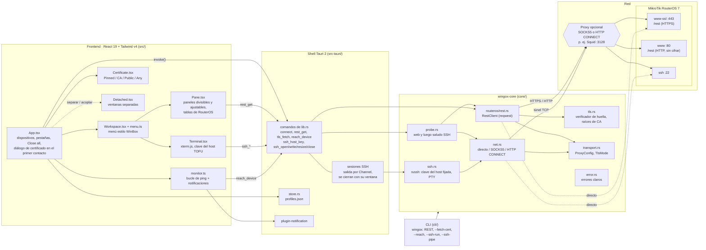

# Wingox — Diseño técnico

> Estado: borrador · 2026-11-05 · Trabajando en local (aún sin repositorio Git).
> Este documento y su gemelo en inglés ([DESIGN.en.md](DESIGN.en.md)) se
> mantienen sincronizados: al cambiar el diseño, cambia los dos.

## 1. Resumen

**Wingox** es una aplicación de escritorio multiplataforma para
gestionar routers MikroTik (RouterOS), pensada como una alternativa moderna a
**WinBox**.

**Por qué existe.** WinBox no tiene ajuste de proxy, así que no puedes gestionar
un router que está en otra red, detrás de un proxy o de un salto (jump host).
Esta aplicación hace que **conectar a través de un proxy o un salto SSH sea una
función de primera clase**: cada conexión guardada puede enrutar su tráfico por
un proxy SOCKS5 / HTTP CONNECT o por un salto SSH. Además añade lo que a WinBox
le falta: gestionar muchos routers a la vez, **versionado y comparación (diffs)**
de configuración, **automatización** y **observabilidad**.

Se construye sobre las **APIs oficiales de RouterOS** (REST y la API binaria),
no sobre el protocolo propietario de WinBox.

## 2. Contexto: cómo funciona WinBox

De una pasada de ingeniería inversa estática sobre WinBox 4 (`WinBox.exe`):

- WinBox 4 es una aplicación **Qt 6.8.8 / QML**, multiplataforma (WinBox 3 era
  un binario Win32 nativo diminuto).
- Es un **renderizador genérico, no un conjunto de pantallas fijas.** No lleva
  rutas de menú de RouterOS. Al conectarse descarga del router un *fichero
  índice*, *skins* y ficheros **JavaScript**, y con ellos construye los menús y
  la lógica de cada pantalla. Las funciones que ves en WinBox vienen de
  RouterOS, no de WinBox.
- El transporte es un protocolo propietario sobre **TCP 8291**, con mensajes
  nombre-valor tipados (`nv::message`) y una subcapa de transferencia de ficheros
  por *chunks* (`mproxy`).

**Lo que implica para nosotros.** No reimplementamos las pantallas de WinBox.
Construimos un *cliente* mejor sobre APIs documentadas y dejamos que RouterOS sea
la fuente de verdad de lo que un router puede hacer. El protocolo propietario
8291 queda **fuera del alcance de la v1**; solo hace falta para llegar a un
router sin configurar y sin IP (la conexión por MAC / vecinos de WinBox).
Podríamos hacerle ingeniería inversa más adelante si ese caso importa.

## 3. Objetivos y no-objetivos

**Objetivos**
- Conectar a RouterOS a través de un proxy o un salto SSH opcional (la razón del proyecto).
- Construir sobre las APIs oficiales de RouterOS (REST + API binaria).
- Escritorio multiplataforma (Windows, macOS, Linux).
- Gestionar muchos routers: inventario, grupos, acciones en lote.
- Versionado, comparación (diffs) y reversión de configuración.
- Automatización: plantillas, scripts, tareas programadas, aplicación declarativa con simulación previa (dry-run).
- Observabilidad: métricas en vivo, gráficas, topología descubierta.
- Seguro por defecto: un "modo seguro" / simulación antes de aplicar cambios; secretos nunca en texto plano.

**No-objetivos (v1)**
- Hacer ingeniería inversa o reimplementar el protocolo propietario 8291 de WinBox.
- Conexión por MAC / vecinos a un router sin configurar y sin IP.
- Apps móviles.
- Gestionar dispositivos que no sean MikroTik.

## 4. Arquitectura

Una aplicación **Tauri 2**: un núcleo en Rust más una interfaz React/TypeScript
en el webview.

Por qué Tauri: el sandbox del navegador no puede abrir TCP crudo, hacer su
propio TLS ni hablar SOCKS5 / SSH. El lado Rust sí, que es justo lo que
necesitan la conexión por proxy y la API binaria. Tauri además da binarios
pequeños y los tres sistemas de escritorio desde un solo código, y reutiliza el
stack React/TypeScript que ya usas en visual-tracert.

```
┌──────────────────────────────────────────────┐
│ Interfaz — React / TypeScript (webview)      │
│  inventario · editor de conexión · explorador │
│  diffs · automatización · paneles            │
└───────────────┬──────────────────────────────┘
                │ comandos Tauri (IPC tipado)
┌───────────────▼──────────────────────────────┐
│ Núcleo — Rust                                │
│  • gestor de conexiones                      │
│  • transporte: directo │ SOCKS5 │ HTTP CONNECT │ salto SSH
│  • clientes RouterOS: REST (HTTPS) · API binaria (8728/8729)
│  • almacén: SQLite (metadatos) + llavero del SO (secretos)
│  • servicios: inventario · snapshots · automatización · telemetría
└───────────────┬──────────────────────────────┘
                │ directo / SOCKS5 / HTTP CONNECT / SSH direct-tcpip
┌───────────────▼──────────────────────────────┐
│ Dispositivos RouterOS (REST / API binaria)   │
└──────────────────────────────────────────────┘
```

### 4.1 Tal como está construido (v0.1.0-alpha.1)

El esquema de arriba es el diseño objetivo. Esto es lo que existe hoy: la UI
nunca abre conexiones por sí misma, todo pasa por `invoke()` a los comandos de
Tauri; el REST usa reqwest (que gestiona el proxy por su cuenta), mientras que
el SSH y el sondeo del monitor necesitan el flujo TCP en bruto y lo obtienen de
`net.rs`.



## 5. Conexión con RouterOS

### 5.1 Las APIs oficiales

- **API REST** — solo RouterOS **7.1+**. HTTPS en el servicio `www-ssl` del
  dispositivo, ruta base `/rest`, autenticación HTTP Basic, cuerpos JSON. El
  CRUD mapea al árbol de configuración, p. ej. `GET /rest/system/resource`,
  `GET /rest/interface`, `PATCH /rest/ip/address/<id>`, `PUT /rest/ip/address`,
  `POST .../add`, `DELETE`. Requiere `www-ssl` activado con un certificado en el
  router. Un `www-ssl` con `certificate=none` solo ofrece cifrados anónimos (ADH),
  que ningún cliente TLS moderno acepta: el handshake falla con la alerta
  `handshake_failure`, y Wingox lo indica explícitamente. Para esos routers un
  perfil puede elegir **Protocolo = HTTP** (el servicio `www`, puerto 80): el REST
  funciona igual, pero nada va cifrado — el usuario/contraseña de Basic auth y
  todos los datos cruzan el proxy y la red en texto plano. La UI muestra un aviso
  destacado al elegir ese protocolo y marca el dispositivo y su pestaña como sin
  cifrar; la solución real es asignar un certificado a `www-ssl`.
- **Confiar en el certificado** — por perfil, uno de: **Pinned** (por defecto:
  confianza en el primer uso — en el primer contacto se muestra la huella SHA-256,
  leída con un handshake que se aborta antes de enviar nada, y desde entonces solo
  se acepta ese certificado exacto; un cambio se rechaza con una alerta clara;
  coincide con el `fingerprint` de `/certificate print` de RouterOS), **Trusted CA**
  (un PEM; se verifican cadena y nombre — para CA internas), **Public CA** (las
  raíces públicas incluidas) o **Accept any** (inseguro, con aviso). El pinning es
  un verificador propio de rustls que sigue comprobando las firmas del handshake.
- **Terminal del dispositivo (SSH)** — "New Terminal" abre un CLI real de
  RouterOS (xterm.js) por SSH (`russh`, cripto ring) por la ruta del perfil:
  directo, SOCKS5 (con autenticación) o HTTP CONNECT — los handshakes de proxy
  están en `core/src/net.rs`. La clave del host se fija por perfil con su huella
  `SHA256:` de OpenSSH: el primer contacto la muestra (leída antes de
  autenticarse, así ninguna contraseña va a un host sin verificar) y una clave
  distinta se rechaza con una alerta clara. Cada panel de terminal es su propia
  sesión; las sesiones sobreviven a dividir/mover paneles y terminan con su
  panel, pestaña, ventana o "Close all". RouterOS sondea el tamaño del terminal
  con consultas de posición del cursor, que xterm.js responde; para scripts la
  CLI usa el sufijo de login `+ct` de RouterOS.
- **Monitor de alcance** — los perfiles se pueden vigilar. Un ping ICMP no
  atraviesa un proxy SOCKS/HTTP (solo transportan TCP), así que cada ronda sondea
  los servicios TCP del router por su propia ruta (proxy incluido), sin
  credenciales: su servicio web y después su puerto SSH (el saludo `SSH-`). Si
  responde cualquiera = arriba. Dos rondas fallidas seguidas = caído → aviso en la
  app + notificación del sistema; también se avisa cuando vuelve. Si el proxy
  rechaza todos los puertos (p. ej. las ACL de CONNECT de Squid), el dispositivo
  aparece como "no se puede sondear por este proxy" — no caído, sin alerta.
- **API binaria** — RouterOS 6 y 7. Texto plano en **8728**, TLS en **8729**
  (el servicio `api-ssl`). Un protocolo de frases/palabras: los comandos son
  rutas con `/` (`/login`, `/interface/print`, `/ip/address/add`), cada palabra
  con su longitud delante; las respuestas son `!re` (fila), `!done`, `!trap`
  (error), `!fatal`. El login en RouterOS **6.43+** manda la contraseña en un
  solo `/login` con `=name=`/`=password=`, así que **debe ir sobre TLS (8729)**;
  el firmware más antiguo usaba desafío-respuesta MD5.

**Estrategia de cliente.** Preferir REST en RouterOS 7; recurrir a la API
binaria (y para RouterOS 6). Ocultar ambas tras un único *trait*
`RouterOsClient` para que el resto de la app no dependa de qué transporte
respondió. El cliente detecta la versión (`/system/resource`) y elige la API.

### 5.2 TLS

RouterOS trae un certificado **autofirmado**, así que la verificación estricta
falla de fábrica. Cada conexión lleva un modo TLS:

- **verify** — validación de cadena estándar (para routers con certificado real).
- **pin** — confiar en una huella de certificado concreta (confianza al primer uso).
- **accept-invalid** — saltar la verificación (solo laboratorio; con un aviso claro).

Por defecto: **fijación TOFU** (*trust-on-first-use*) — en la primera conexión,
se muestra la huella y se recuerda; se avisa con fuerza si alguna vez cambia.

### 5.3 Proxy y salto SSH (la función estrella)

Cada conexión tiene una **ruta al dispositivo** opcional:

- **ninguna** — conexión directa.
- **SOCKS5** — abre el flujo TCP a través de un proxy SOCKS5 (con autenticación opcional).
- **HTTP CONNECT** — túnel por el método `CONNECT` de un proxy HTTP.
- **salto SSH** — abre una sesión SSH a un host de salto, luego un canal
  `direct-tcpip` hacia `destino:puerto`, y corre la API/TLS por ese canal.

El núcleo en Rust construye **primero** el flujo TCP por la ruta elegida y
luego coloca encima TLS y el protocolo de RouterOS, así el proxy funciona igual
para REST y para la API binaria. Las cadenas de varios saltos (salto → salto →
dispositivo) son una incorporación posterior.

Crates: `tokio` (E/S asíncrona), `tokio-socks` (SOCKS5), `reqwest` (HTTPS con
soporte integrado de proxy SOCKS5/HTTP para REST), `russh` (cliente SSH en Rust
puro para el salto), `rustls` o `native-tls` (TLS).

## 6. Modelo de datos

- **Conexión**: `id`, `nombre`, `host`, `puerto`, `apiKind` (rest | binary),
  `tls` (modo + huella fijada opcional), `credencialesRef`, `proxyRef?`,
  `grupoId?`, `tags[]`.
- **Proxy**: `id`, `tipo` (socks5 | http | ssh), `host`, `puerto`, autenticación
  (usuario/contraseña, o para SSH: clave/passphrase/contraseña + known-host).
- **Credenciales**: guardadas en el **llavero del SO** (con el crate `keyring`);
  la base de datos solo guarda una referencia, nunca el secreto.
- **Grupo / inventario**: nombre, miembros, valores por defecto compartidos
  (proxy, credenciales).
- **Snapshot**: una exportación de config (`/export`), marca de tiempo, hash del
  contenido, nota — la base del versionado y los diffs.
- **Job**: una unidad de automatización (aplicar plantilla, script, tarea
  programada) con sus ejecuciones y resultados.
- **Muestra de métrica**: puntos de serie temporal para las vistas de observabilidad.

**Almacenamiento**: **SQLite** para los metadatos (con `rusqlite`), el **llavero
del SO** para los secretos. Ningún secreto se escribe en la base de datos ni en
los registros.

## 7. Funciones y hoja de ruta

1. **MVP — probar el proxy.** Dar de alta una conexión con proxy/salto opcional;
   el backend en Rust conecta (REST y/o API binaria) por esa ruta y muestra
   datos reales (identidad, versión de RouterOS, interfaces). Esto valida todo
   el stack y la idea central.
2. **Explorador / editor de recursos** — navegar y editar el árbol de
   configuración (interfaces, direcciones, rutas, firewall, etc.) por la API.
3. **Multi-router** — inventario, grupos, un panel y acciones en lote sobre
   muchos dispositivos.
4. **Versionado y diffs** — snapshots de configuración periódicos y a demanda,
   comparación visual entre dos puntos, y reversión.
5. **Automatización** — plantillas y scripts reutilizables, tareas programadas,
   variables y un "aplica esta config" declarativo con una **simulación
   (dry-run)** que muestra el cambio antes de ejecutarlo.
6. **Observabilidad** — métricas y gráficas en vivo (CPU, tráfico, sesiones),
   alertas y una topología descubierta que puede alimentar / compartir conceptos
   con visual-tracert.

## 8. Seguridad

Esta app guarda **credenciales de administrador de routers**, así que la
seguridad es una preocupación de primer orden:

- Los secretos (contraseñas de routers, credenciales de proxy/SSH) viven solo en
  el **llavero del SO**; la base de datos guarda referencias. Nada secreto se
  registra.
- La verificación TLS es configurable por conexión, con **fijación al primer uso
  (TOFU)** por defecto y un aviso fuerte si cambia una huella.
- Los cambios en un router pasan, donde se pueda, por una ruta de **simulación /
  modo seguro**, para que un error se pueda previsualizar y revertir.
- Los registros ocultan secretos y campos sensibles.
- La app es **solo local**: sin nube, sin telemetría, sin llamadas salientes
  salvo a los routers y proxies que el usuario configure.

## 9. Pila tecnológica

- **Frontend**: React 19 + TypeScript + Vite + Zustand (la familia de
  visual-tracert), opcionalmente React Query para el estado de servidor.
- **Interfaz y lenguaje de diseño**: Tailwind CSS con un sistema de tokens de
  tema — **oscuro por defecto**, más temas claro y de acento con variables CSS;
  **Radix UI** para primitivos accesibles sin estilo (diálogo, menú, pestañas,
  tooltip); iconos `lucide-react`. Un aspecto **estilo terminal** refinado:
  bordes nítidos, espaciado generoso, **JetBrains Mono** para datos/direcciones
  e **Inter** para la interfaz — muy legible y cómodo de usar.
- **Backend (núcleo)**: Rust — `tokio`, `reqwest`, `rustls`/`native-tls`,
  `tokio-socks`, `russh`, `rusqlite`, `keyring`, `serde`.
- **Cáscara**: **Tauri 2** (Rust ↔ webview, comandos tipados).
- **Pruebas**: contra el **RouterOS CHR** que ya corre en el emulador de
  visual-tracert; tests unitarios de la capa de transporte/proxy; tests de
  integración tras un *feature flag* para que la CI no necesite un router real.

## 10. Estructura del proyecto (prevista)

```
routeros-manager/
  README.md
  docs/
    DESIGN.en.md        # este documento (inglés)
    DESIGN.es.md        # su gemelo en español
  src/                  # interfaz React / TypeScript
  src-tauri/            # núcleo en Rust (app Tauri)
    src/
      transport/        # directo, socks5, http-connect, salto ssh
      routeros/         # cliente rest, cliente api binaria, trait de cliente
      store/            # sqlite + llavero
      services/         # inventario, snapshots, automatización, telemetría
      commands.rs       # superficie de comandos Tauri
```

## 11. Decisiones y preguntas abiertas

**Decidido (2026-11-05):**
- Nombre del producto: **Wingox**.
- **API REST primero** (solo RouterOS 7) para el MVP; la API binaria y RouterOS 6 vienen después.
- Crate de SSH: **`russh`** (Rust puro, asíncrono).
- Interfaz: **Tailwind + Radix**, aspecto terminal oscuro por defecto (ver §9).

**Aún abierto:**
- Paleta de acento y escala tipográfica exacta.
- Cuánto del "modo seguro" (reversión) podemos obtener de las APIs frente a que sea una función solo de WinBox.

## 12. Entorno de desarrollo

El desarrollo ocurre en una Raspberry Pi sin pantalla (donde vive el RouterOS de
pruebas); la GUI de escritorio la ejecuta el desarrollador en su propia máquina.

- **Destino de pruebas**: la imagen **RouterOS CHR 7.23.8** del emulador de
  visual-tracert (`visual-tracert/vr-routeros:7.23.8`). El MVP activa el servicio
  `www-ssl` (REST) en ella y conecta a través de un proxy.
- El **núcleo en Rust** se construye y se prueba sin pantalla (una pequeña CLI
  demuestra el flujo de conexión-por-proxy). La **cáscara Tauri** y su GUI se
  conectan y ejecutan en la máquina del desarrollador, no en la Pi.
